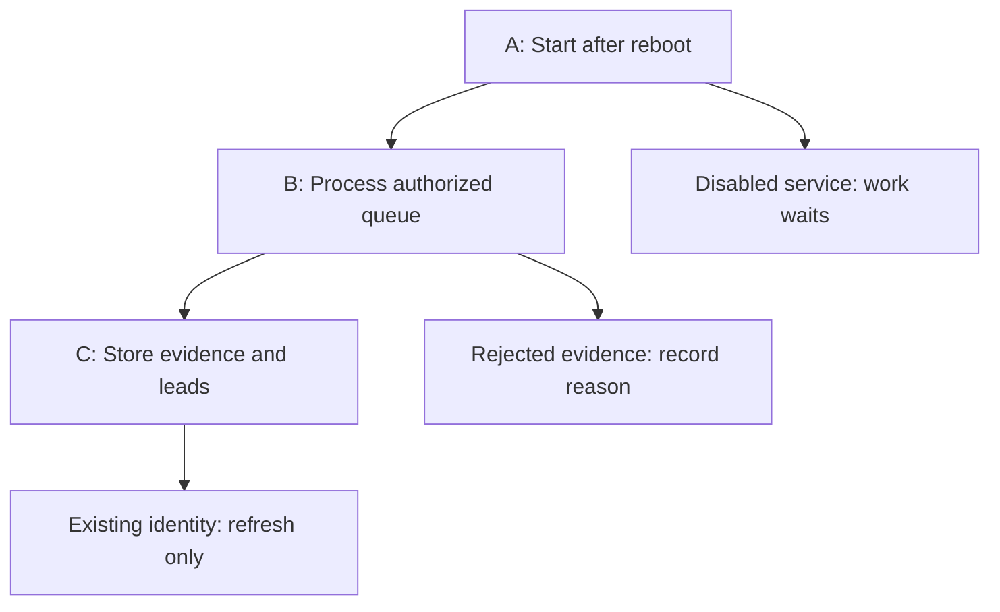

# Campaign 2 recovery and yield audit — 2026-10-19

Baseline: remote `work/campaign2-intake-precision` verified by `git ls-remote` at
`10f37e8538e634ad46b000a8db49f5475e65e4d2`. Work is local on
`fix/campaign2-recovery-and-yield`. The user authorized this baseline as an exception
to AGENTS.md's main-branch instruction. No production host/data was inspected.
All runtime numbers in the request are historical, operator-supplied evidence.

## A → B → C

A. Enabled supervisor starts the web launcher and ONE leased collector after boot.
B. Discovery/search/index registration feeds authorized, ranked URLs into the SQLite
queue; setup probes, evidence validation and canaries establish usable recipes.
C. Person-bound published channels pass role/evidence validation → observations →
conservatively matched lead identities. Refreshing old evidence creates no new lead.

A stopped collector breaks A→B even if an independent index timer keeps registering URLs.
A valid company judgment alone never supplies a missing person/contact relationship.

## Repository execution paths and findings

| Lane | Exact files/functions | Finding and confidence |
|---|---|---|
| Supervisor | `run-local.py:main`; `leads/management/commands/worker.py:Command.handle`; `docs/DEPLOYMENT.md`; capacity/ranking handoff Rollout/Rollback | Confirmed: launcher restarts neither itself nor child processes; it exits if a child exits. No tracked systemd units, install/upgrade helper, enablement verification or state-preserving rollback exists at baseline. Handwritten stop/switch/start instructions do not establish boot enablement. Disabled service/linger/host reboot are configuration facts supplied by operator, not locally observed. Who disabled it is unknown. |
| Lease | `leads/services/worker.py:acquire_lease,heartbeat,release_lease,tick` | Confirmed: fresh token blocks acquisition for 600 seconds; stale OR empty lease permits replacement. Acquisition atomically requeues processing PageJob/DiscoveryJob only for open runs; clears setup processing; retains paid uncertain reservations. No need for a new worker framework. Queued work already survives restart. Paused runs stay paused. |
| Discovery | `discovery/services.py:start,schedule_due,tick,process,finish`; `discovery/models.py:DiscoveryRun,DiscoveryJob` | Open-run and per-run job uniqueness constraints prevent ordinary duplicate scheduling. Run 186 should resume existing due jobs after lease acquisition if campaign/source/scope gates allow. A queued run with zero jobs has no dispatch event to call finish and can remain open forever: reproduce and repair only this case. No evidence that Run 186 itself is empty. |
| Common Crawl | `discovery/management/commands/discovery_commoncrawl.py:Command.handle`; `discovery/services.py:common_crawl_specs,register_common_crawl,register_batch` | Command can register work into an open active run without a collector lease; --start-if-idle opens ordinary work first. Registration does not fetch targets. A separate timer can therefore keep filling inventory while collector is off. Repository contains no actual installed unit; stale b2161bc configuration is snapshot evidence, requiring later host readback. Synthetic Jev soak is a distinct database and must not be repointed. |
| Failure visibility | `discovery/services.py:process,done,finish,pause,save_page`; `leads/services/worker.py:block_source` | Confirmed defect: finish sets failed when ANY job failed, without setting DiscoveryRun.message. A run can save 35 pages, refresh 8 contacts, fail another page and show a blank run message. Zero new identities is not evidence of extraction failure. Exact historical failing jobs remain unknown without their records. |
| Extraction | `leads/services/extraction.py:soup_for,extract,extract_rules,card_record,evidence_node,contact_evidence,validate_record`; `automation/recipes.py:proposals,evaluate,readiness`; `automation/services.py:validate_candidates,validate_canary,monitor_page` | CSS recipes bind descendants to row/evidence containers. Visible inference requires one name and one channel; automation additionally rejects multi-person/chrome containers and removes generic/repeated/global channels. Shared fallback is separately opt-in and labelled. A narrow defect is provable offline: case-sensitive href selectors lose uppercase MAILTO:/TEL: links with non-address labels, although selected_text/contact_evidence already recognize these schemes case-insensitively. No evidence authorizes broad proximity expansion or accepting arbitrary adjacent page channels. |
| Structured/evidence | `leads/services/structured.py:entities`; `classification/evidence.py:capture_page,usable_rows,candidate_blocks,contacts_for,add_span`; `classification/services.py:enqueue_subject`; `classification/routing.py` | Structured Person properties require explicit employer (or operator-confirmed structured_employer for accepted extraction), no remote joins. Jev capture can preserve candidates before sales acceptance; bounded fallback blocks are opt-in. Exact spans are derived-document spans with locators, not raw HTML offsets. Omitted card segmentation can prevent person evidence even when company classification succeeds. This is a plausible historical cause, not proven on production HTML. |
| Storage | `leads/services/storage.py:save_records,identity,page_identity,continuous,touch_unchanged,record_review`; `leads/services/reporting.py:production_leads,production_totals` | Existing identities/observations refresh conservatively; same-name suppression holds persist. Production totals exclude demo-only evidence. contacts_seen counts accepted/refreshed observations, not novel identities. New-contact counters in discovery currently count all collectors; diagnostics must label non-demo creation separately. |
| Roles | `leads/services/extraction.py:SALES_ROLE,validate_record,shared_contact_lead`; `automation/recipes.py:evaluate`; `automation/assessments.py:build,richest,record` | Regex already covers sales, account executive/manager, business development, reseller, ISO, independent agent/rep and sector-qualified consultant/agent/advisor/broker/specialist. Unqualified agent/channel partner/relationship manager/territory manager/acquiring specialist are not consistently covered. Broadening these without sector context risks false positives. non_sales_role can be genuine. Titles, association and deliverability are separate questions; no mailbox verification exists. Defer taxonomy changes to dedicated positive/negative fixtures. |
| Queries | `discovery/acquisition.py:query_pool,schedule,process,complete`; `discovery/services.py:process` legacy search branch; `discovery/models.py:SourceSearch`; `discovery/yields.py:search_priority` | Precision changes ONLY generated queries: explicit search_queries remain exact, so an old-style exact query is valid even when precision=true. schedule stores rows; process refreshes campaign and skips queries outside the current pool before reserve_budget/provider call. However, readiness check precedes invalidation, leaving stale rows deferred when provider is off. Legacy DiscoveryJob search path lacks pool membership check. Cursor persists next pool index; ties rotate deterministically, priorities use randomized Thompson sampling. No history of setting-change timestamps or code revision on SourceSearch, so October 5 cause cannot be distinguished from these possibilities using repository alone. |
| Ranking | `automation/intake.py:rank_pool,ranked_sites,admit,explore_cap`; `automation/policy.py:admission_gate,consider`; `automation/learning.py:query_setup_stats,family_outcomes,family_adjustment,admission_funnel`; `discovery/yields.py:origin_yields,query_yields,yield_adjustment` | Already uses tier, origin yield, query setup outcomes and family outcomes. Boosts/penalties bounded; explorer cap rounded up; no approval changes. Existing per-site source exclusion and family-per-day guard prevent repeated exploratory sibling slots. no_people and contacts_rejected remain separate durable outcomes but share soft content penalty. Transport/unavailable/setup errors deliberately excluded from query learning. No proven ranking defect justifies new scoring. |

## Ranked backlog and first slice

- P0 configuration: later operator must inspect installed units/drop-ins, linger and enabled states;
  explicitly enable service, use default.target and Restart=on-failure, align Common Crawl
  checkout with intended application revision. Preserve separate Jev soak and its database.
- P0 code/tests: regression coverage for queued/processing/stale/empty leases and offline
  index registration; close empty orphan runs without duplicating work or unpausing campaigns.
- P1 visibility: durable run/job reason categories, safe terminal messages, persisted aggregate
  extraction diagnostics and a read-only status report. Old counts cannot be reconstructed.
- P1 association: RED fixtures for uppercase contact URI schemes, then normalize only the
  scheme before existing selectors/evidence checks. Retain all containment and release gates.
- P2 roles: versioned taxonomy and context-specific positive/negative fixtures, separate from
  ownership and deliverability; not part of this first slice.
- P2 query: stale-pool rows skipped before provider readiness/budget checks; regression for
  precision generation, exact operator queries, deterministic cursor ties and legacy queue.
- P2 ranking: retain existing behavior pending real outcome evidence. Do not interpret 76
  paused/23 failed jobs as evidence ranking is absent or that approval should be expanded.

## Limits and later evidence needed

No production settings, unit definitions, job records, probe HTML or configuration-change
history are available here. Historical source-role relevance and ambiguous card layouts
cannot be conclusively diagnosed from aggregate counts. No broad normalized candidate-object
refactor, generic DOM segmentation, automatic resume of paused setup jobs, or threshold changes
are justified in this slice. Synthetic regression success is not a production yield claim.

## Implemented first slice

- `leads/services/worker.py:acquire_lease` closes only active-campaign, open runs older
  than the lease window that have no jobs at all. Existing jobs stay on their original
  run. Interrupted discovery jobs retain a durable worker_interruptions count.
- `discovery/diagnostics.py:failure_category,extraction_counts,summarize,terminal` adds
  fixed error categories and aggregate counts. `DiscoveryRun.terminal_reason/diagnostics`
  and `DiscoveryJob.failure_code/diagnostics` persist results. Migration 0011 backfills
  legacy blank failures as legacy_unknown and adds a database constraint for failed/paused
  run messages and reasons. It never invents historical causes. Missing historical creation
  measurements produce null for new_non_synthetic_leads; cached refreshes measure creation
  independently from extraction and report zero correctly.
- `discovery/services.py:finish,pause,save_page,process` persists safe terminal summaries,
  captures extraction counts (including automatic-recipe stats), and retains HTTP status /
  robots labels without saving exception bodies. Counts are card/channel candidates, not
  confirmed unique people or deliverable mailboxes. pages_fetched counts page jobs with a
  response, not HTTP requests/retries; pages_saved is the existing successful-save counter.
  Accepted observations include refreshes. duplicates counts duplicate extracted records,
  not all refreshed identities. `coverage` makes missing historical/cached extraction metrics explicit.
- `leads/management/commands/crawler_status.py:Command.handle` reports queues, reasons,
  lease state/age and optional explicit user-unit revision/loopback HTTP checks. It performs
  no database writes. `leads/services/supervision.py` and
  `scripts/guard_service_update.py` record and restore enablement/activity around reviewed
  update/rollback scripts with readback. Tests mock ALL systemctl calls. They do not verify
  actual boot, linger, deployed unit paths or a real rollback. See SYSTEMD_RECOVERY.md for
  exact operator commands, template installation, interrupted-deploy recovery and schema rollback.
- `leads/services/extraction.py:soup_for` normalizes ONLY mailto/tel URI schemes, preserving
  target values and existing containment validation. Version 0.4.1 changes cache signatures
  so previously unchanged pages are extracted once under the correction. RED synthetic
  fixtures cover cards, real table cells, lists and repeated sections; footer/neighbor channels
  stay unassociated. A storage-path test creates one fictional non-demo lead/observation and
  verifies a cached refresh creates neither a duplicate nor a false new-lead count. Existing
  JSON-LD/Microdata fixtures and held-out benchmark retain structured association safeguards.
- `discovery/acquisition.py:process` skips stale pool rows before provider readiness/quota
  checks and makes replacement scheduling due on the next tick; ordinary budgets and cooldowns
  still apply. `discovery/services.py:process` adds the same membership check to legacy search
  jobs. Exact operator queries remain valid and unchanged. No query-budget or ranking change.

The role taxonomy and a broad normalized person-card object/proximity engine are deferred:
there is no retained production HTML here proving a safe segmentation expansion. This is a
bounded correction, not a claim that uppercase URI schemes explain historical zero yield.

## Verification

All runs used a fresh throwaway DATA_DIR and SQLite test databases, a clean inherited
configuration with a random secret, ACTIVITY_LOG=off, BRAVE_SEARCH_ENABLED=0,
COMMON_CRAWL_ENABLED=0 and JEV_MODE=off. Tests that exercise providers override them
with mocks. A temporary sitecustomize guard blocked non-loopback socket connections;
process smokes used localhost only. No setup.py bootstrap or production .env was used.
Dependencies were installed into this checkout's fresh .venv from requirements.txt.

| Command (inside the clean temporary environment) | Final result |
|---|---|
| `.venv/bin/python manage.py check` | No issues |
| `.venv/bin/python manage.py makemigrations --check --dry-run` | No changes detected |
| `.venv/bin/python manage.py test --noinput` | 708 tests passed in 77.013 seconds, exit 0 |
| `.venv/bin/python scripts/smoke_local.py` | PASS, exit 0 |
| `.venv/bin/python scripts/smoke_inventory.py` | PASS, exit 0 |
| `.venv/bin/python scripts/smoke_jev.py` | PASS, exit 0 |
| `.venv/bin/python scripts/smoke_extraction.py` | PASS, exit 0 |
| `.venv/bin/python scripts/run_smoke_bulk_import.py` | PASS, exit 0; bulk smoke invoked only through its isolating runner |
| `.venv/bin/python manage.py benchmark_extraction --assert-fixtures` | PASS, exit 0; 10/10 held-out pairs, zero extras |
| Throwaway MigrationExecutor forward/backward/reapply check | PASS; legacy blank failure backfilled, existing run retained |
| `git diff --check` | PASS |

27 new test methods cover recovery (4), diagnostic/storage/HTTP safeguards (8), URI-case
association (3, with layout subtests), systemd state/readback (7) and precision queues (5).
RED results before fixes: empty-run recovery failed; association failed on three layout
subtests and repeated sections; diagnostics failed on absent fields/command; stale generated
current and legacy rows failed; immediate replacement scheduling failed. GREEN focused runs
passed after each correction. The first full suite found two existing HTTP assertions needing
the fixed status and robots.txt label; the implementation restored those safe details instead
of weakening those tests. A clean-checkout missing-staticfiles warning is benign; no static
asset build or production configuration was needed.

## Next production validation — recommended, not performed

Review this branch and SYSTEMD_RECOVERY.md first. A separately authorized operator should
read back actual lead/Common Crawl unit paths, enabled/active state, linger, revision and one
worker process tree. Establish who/what disabled the service from private host logs if retained;
do not attribute that to code without evidence. Keep Jev soak separate. Validate migration and
read-only reports on an isolated backup before approving any deployment. After an authorized
release/reboot, confirm existing queued run/job IDs advance under one lease, count accepted
observations vs genuinely new non-demo leads, inspect exact retained rejection evidence, and
verify stale generated queries skip without a provider request. Do not requeue paused setup
jobs, change budgets/thresholds or enable additional domains as part of that check.

The production host, credentials and deployment state were not accessed or modified. No paid
provider calls or target-website fetches were made, and no remote branches were modified.
Only repository Git reads and package installation used external network access; verification
used offline/loopback fixtures.

## Follow-up review — 2026-10-19

This is an author second pass, not independent sign-off. The previously reported clean HEAD
was d886ff21bd5a388afdc8d580d63246a070d7d76e. Review found that guarded_update restarted the
unit even if its rollback callback failed. A revised regression was RED on that behavior.
The correction restores prior enablement but leaves the unit stopped with checked readback
when rollback fails, propagating the error. Successful rollback still restores prior activity.

A historical-model insertion into a throwaway migrated database also confirmed that 0011 is
not compatible with old-code writers (new required JSON columns have no database defaults,
besides the terminal-reason constraint). The real deployment must quiesce every writer,
including the separate Common Crawl service/timer, and align compatible checkouts before
resuming them. The single-unit guard cannot establish this by itself. No production unit was
inspected or stopped. Synthetic migration rehearsal was repeated; no actual production-backup
rehearsal was possible because no backup was provided. Independent review remains outstanding.

Follow-up verification: 708 tests passed in 91.682 seconds; 19 focused recovery/diagnostic/supervision tests passed; synthetic migration reversal/reapplication passed. The full-suite result applies to the corrected guard. No new production access or remote write occurred.
